# Shongo · La chispa de la memoria

La historia del almacenamiento, del disquete a la nube, contada con **una sola nube de 110.000 partículas** que cambia de forma mientras haces scroll. Hecho con **Three.js + GSAP + Lenis + Vite**.

**🔗 Ver en vivo: [jhonedinson-shongo.github.io/shongo-memoria](https://jhonedinson-shongo.github.io/shongo-memoria/)**

[](https://github.com/JhonEdinson-Shongo/shongo-memoria/actions/workflows/deploy.yml)


[](https://jhonedinson-shongo.github.io/shongo-memoria/)

## El recorrido

La portada reinterpreta *La creación de Adán*: una mano humana y una robótica a punto de tocarse. **Acerca el cursor al espacio entre los dedos** y salta la chispa; haz clic para encenderla. Al bajar, las mismas partículas se convierten en cada objeto de la historia.

| Prólogo: todo empieza con un bit | 1980 · Disco duro ST-506 |
|---|---|
| 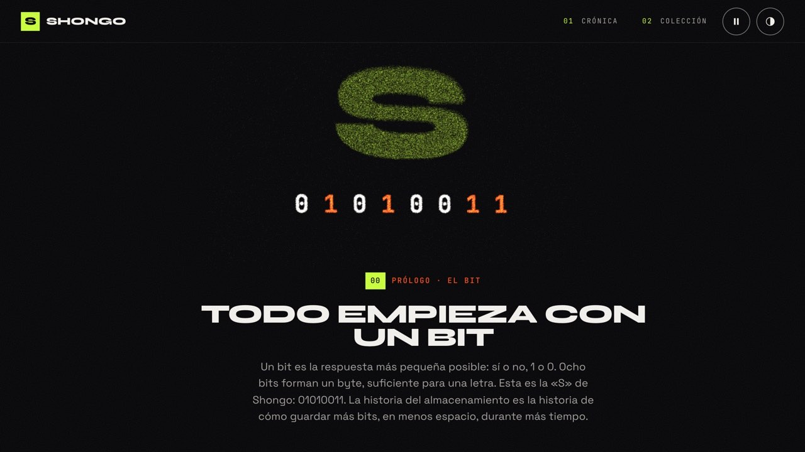 | 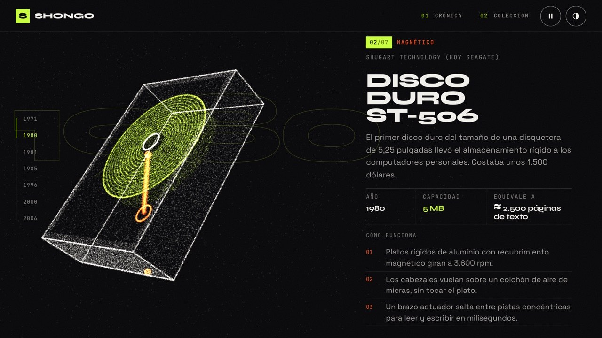 |
| **1985 · CD-ROM** | **2000 · Memoria USB** |
| 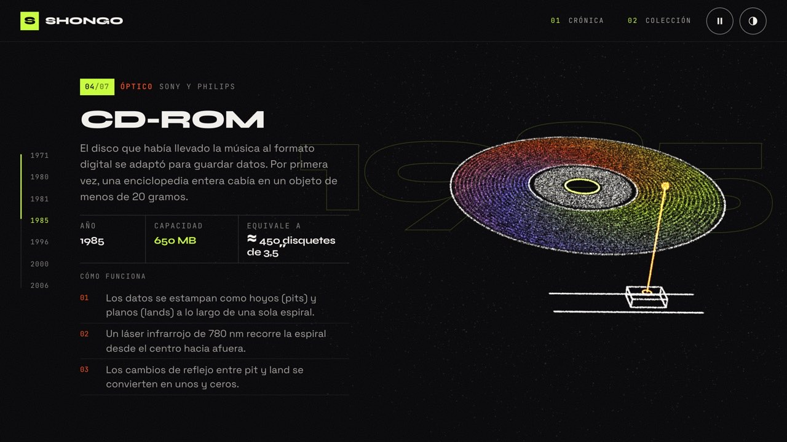 | 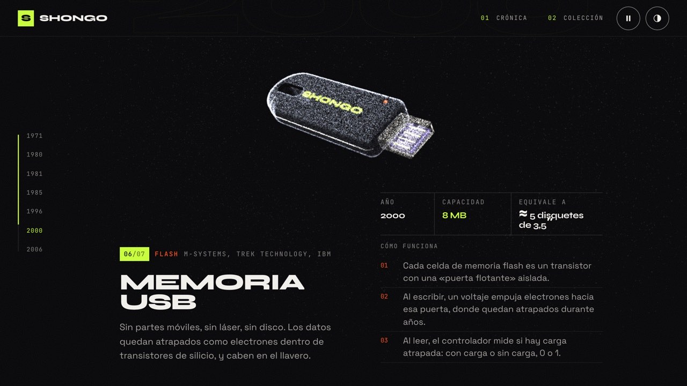 |

Cada capítulo explica **cómo funciona** el objeto, con su año, su capacidad y a qué equivale. Termina en la nube, que no es etérea: es acero, silicio y electricidad.

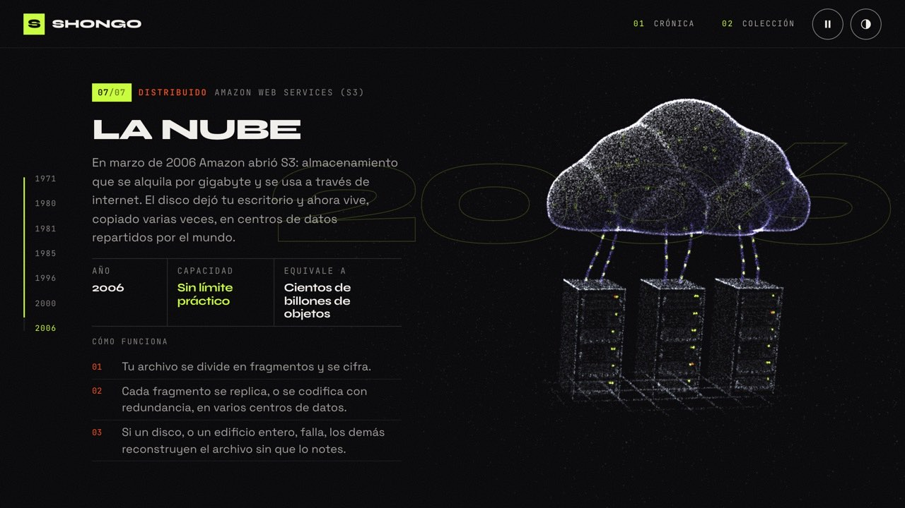

### Tema claro

Con el botón ◐ (o `?theme=light` en la URL) todo cambia a tinta sobre papel, partículas incluidas.

| Portada | Disquete de 3,5″ |
|---|---|
|  | 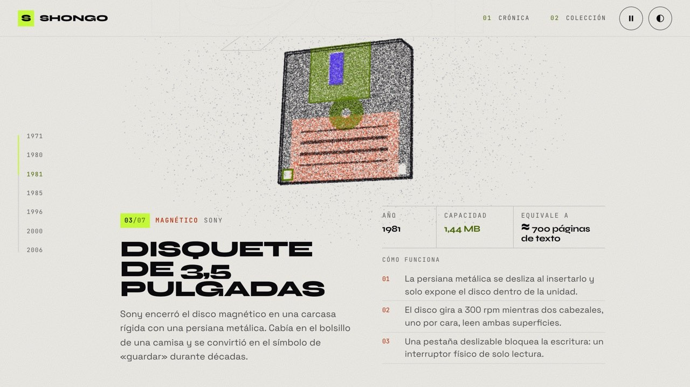 |
| **DVD** | **La nube** |
| 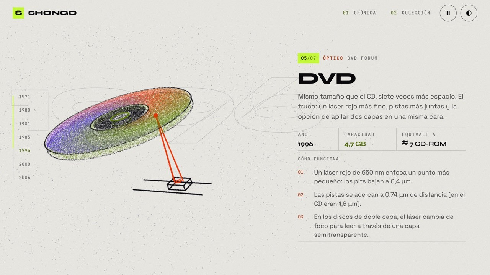 | 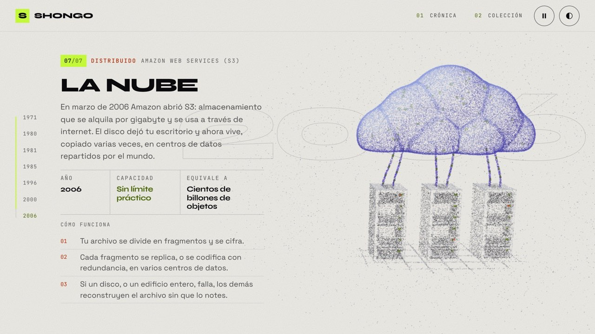 |

### La colección

Al final, un carrusel con los siete objetos. **Ver ficha técnica** abre su detalle: especificaciones, materiales, cómo funciona y un dato curioso.

| Carrusel | Ficha técnica |
|---|---|
| 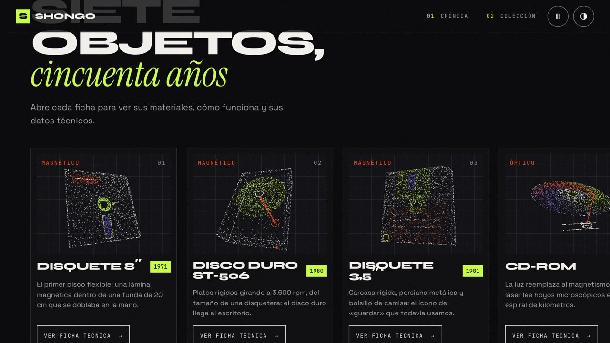 | 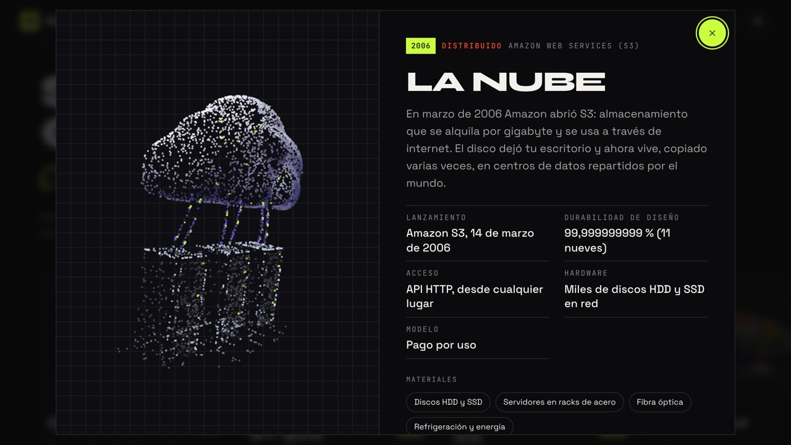 |

### En el celular

| Portada | Capítulo | La nube |
|---|---|---|
| 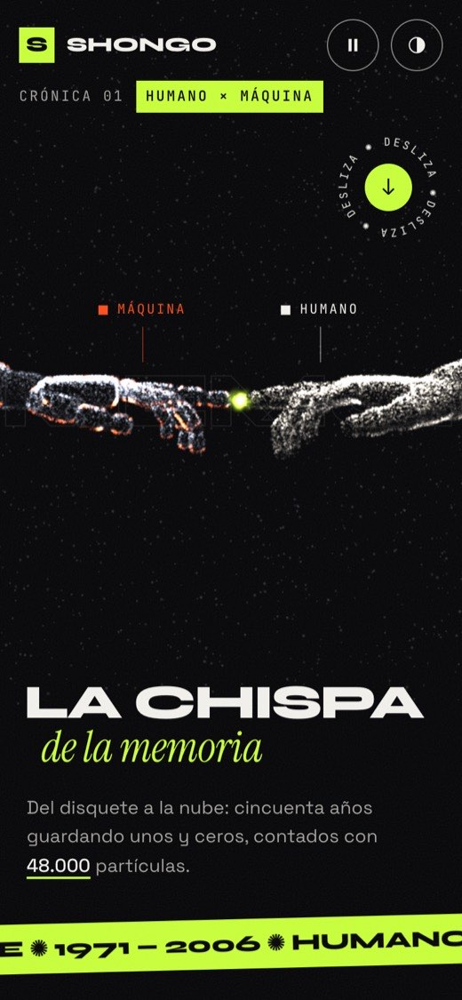 | 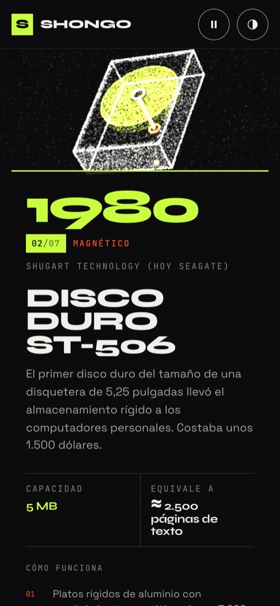 | 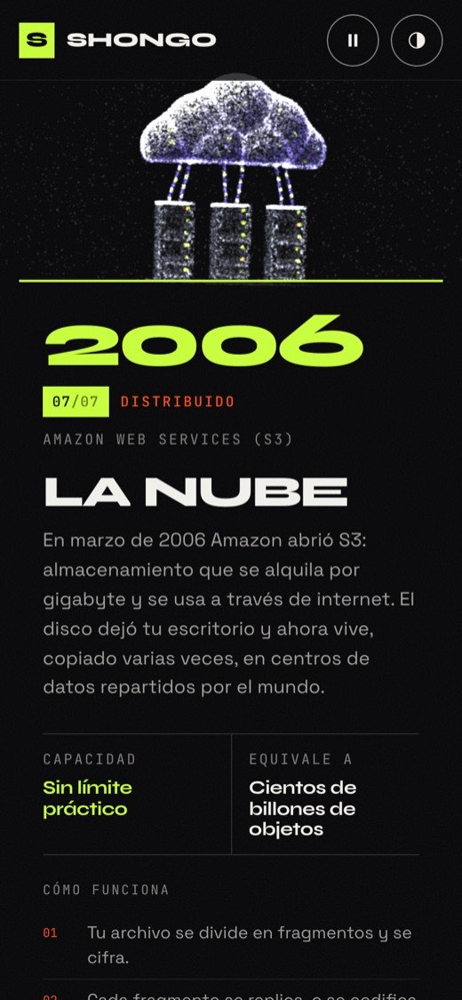 |

### Qué tiene

- **Una sola nube de puntos:** 110.000 partículas en escritorio (48.000 en el celular) que se transforman de un objeto al siguiente. El morph corre en la GPU con un shader propio.
- **Sin modelos descargados:** las manos, el disco duro, la USB, la nube y los servidores se generan con código, a partir de campos de distancia (SDF) con luz precalculada.
- **Una línea de tiempo con el scroll:** GSAP ScrollTrigger con `scrub` mueve, gira y transforma la nube. Lenis suaviza el desplazamiento.
- **Layouts que cambian por capítulo:** texto a la izquierda y modelo a la derecha, al revés, o el modelo arriba y el texto abajo.
- **Tema claro y oscuro** que también recolorea las partículas, con la preferencia guardada.
- **Accesible:** botón para pausar las animaciones, respeta `prefers-reduced-motion`, navegable con teclado, contraste AA y áreas táctiles de 44 px.
- **Rápido:** las formas se calculan en un Web Worker, Three.js se carga aparte y la portada se pinta solo con CSS.
- **Listo para buscadores:** todo el texto, incluidas las fichas técnicas, ya viene en el HTML.

## Arrancar

```bash
npm install     # solo la primera vez
npm run dev     # abre la URL que aparece (normalmente http://localhost:5173)
```

Cada vez que guardas un archivo, el navegador se actualiza solo. Para forzar un tema, agrega `?theme=dark` o `?theme=light` a la URL.

## Estructura

| Archivo | Qué hace |
|---|---|
| `index.html` | El esqueleto de la página. Los capítulos, las tarjetas y el footer se insertan al compilar. |
| `src/content/storage.ts` | **Todo el texto:** capítulos, tarjetas y fichas técnicas de los siete objetos. |
| `src/content/author.ts` | La autoría: nombre, portafolio y redes (footer, meta `author` y JSON-LD). |
| `src/content/render.ts` | Genera el HTML de capítulos, línea de tiempo, tarjetas y footer, y los datos estructurados. |
| `src/three/hands.ts` | La portada: la mano humana y la robótica, modeladas con campos de distancia. |
| `src/three/shapes.ts` | Disquetes, disco duro, CD y DVD, y la «S» del prólogo, convertidos en puntos. |
| `src/three/usb.ts` · `cloud.ts` | La memoria USB, y la nube con sus racks de servidores. |
| `src/three/sdf.ts` | Primitivas (conos, cajas redondeadas, cilindros) y el muestreo de superficies. |
| `src/three/shapes.worker.ts` | Calcula todas las formas fuera del hilo principal. |
| `src/three/shaders.ts` | El morph en la GPU: cada punto viaja de la forma A a la forma B. |
| `src/three/stage.ts` | Escena, cámara, tema y la chispa entre los dedos. |
| `src/three/palette.ts` | Los colores de cada tema, también para las miniaturas del carrusel. |
| `src/ui/scroll.ts` | Lenis y la línea de tiempo de GSAP, medida en píxeles de scroll. |
| `src/ui/carousel.ts` · `modal.ts` | El carrusel (scroll nativo, botones y arrastre) y la ficha técnica en un `<dialog>`. |
| `src/styles/main.css` | El diseño: textura de lienzo, layouts, temas y tipografía. |
| `public/` | Archivos que se copian tal cual: imagen para redes, íconos y manifest. |

## Conceptos clave

1. **Mismo número de puntos en todas las formas.** El punto *i* de una forma viaja al punto *i* de la siguiente. Están ordenados de izquierda a derecha, así que la transformación barre la pantalla como arena que se acomoda.
2. **Un solo número anima todo.** ScrollTrigger solo anima `morph`: `2.5` significa «a mitad de camino entre la forma 2 y la 3». El vertex shader hace el resto, con un retraso propio por punto y un remolino a mitad de camino.
3. **Campos de distancia (SDF).** Cada objeto sólido se describe como una función que dice qué tan lejos está un punto de su superficie. Los puntos se proyectan sobre esa superficie y conservan su normal, lo que permite precalcular la luz y descartar las caras traseras.
4. **Trabajo pesado fuera del hilo principal.** Un Web Worker calcula las nubes de puntos mientras la página ya se ve y responde.
5. **HTML generado al compilar.** Un plugin de Vite escribe capítulos, tarjetas y fichas dentro del HTML: Google los indexa sin ejecutar JavaScript.

## Agregar un capítulo

1. Añade el objeto en `STORAGE` (`src/content/storage.ts`) y su id en `SHAPE_ORDER`.
2. Dibuja su forma en `src/three/shapes.ts` con las primitivas de `kit()` (aristas, caras, anillos, esferas) y regístrala en `OBJECTS`. Para un sólido con luz, sigue el ejemplo de `usb.ts`.
3. Elige su `layout`: `right` (modelo a la derecha), `left` o `top` (modelo arriba y texto abajo).

## Publicar

Cada push a `main` compila el proyecto y lo publica en GitHub Pages con el workflow `.github/workflows/deploy.yml`.

- En GitHub, **Settings → Pages → Source** debe estar en **"GitHub Actions"**.
- `vite.config.ts` usa `base: './'`, así que el mismo build funciona en `usuario.github.io/repo/` y en un dominio propio.

Para probar el build en local:

```bash
npm run build     # revisa los tipos con tsc y genera dist/
npm run preview   # lo sirve tal como quedará publicado
```

### SEO y rendimiento

- **URL pública automática:** el workflow pasa la URL de GitHub Pages (`SITE_URL`) al build. Con ella se generan la URL canónica, Open Graph, Twitter Card, el JSON-LD, `robots.txt` y `sitemap.xml`.
- **Datos estructurados:** `WebSite`, `Article`, `ItemList` (los siete objetos) y `Person` (el autor).
- **Imagen para redes:** `public/og-image.jpg` (1200×630).
- **Fuentes propias** (`@fontsource`, solo caracteres latinos) con fuentes de respaldo ajustadas a las mismas medidas, para que el texto no salte al cargar (CLS ≈ 0).
- **Lighthouse:** SEO 100 · Accesibilidad 100 · Buenas prácticas 100.
- Envía `sitemap.xml` en [Google Search Console](https://search.google.com/search-console) para acelerar la indexación.

## Créditos

- La composición de la portada se inspira en *La creación de Adán*, de Michelangelo Buonarroti (c. 1512). Ambas manos están modeladas con código.
- Tipografías: Syne, Instrument Serif, Space Grotesk y JetBrains Mono (licencia OFL), servidas desde el propio sitio.
- Los datos históricos y técnicos de cada objeto están resumidos en `src/content/storage.ts`.

---

Hecho por [Jhon Castañeda](https://jhoncastaneda.vercel.app/es) · [GitHub](https://github.com/JhonEdinson-Shongo) · [LinkedIn](https://www.linkedin.com/in/jhon-edinson-casta%C3%B1eda-oviedo-6a78311ab)
